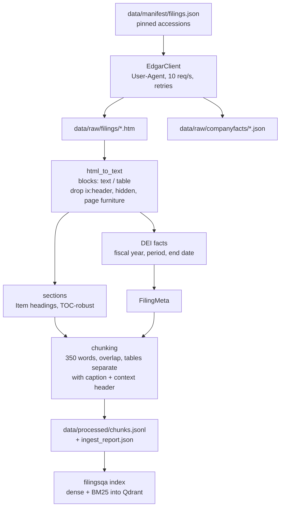
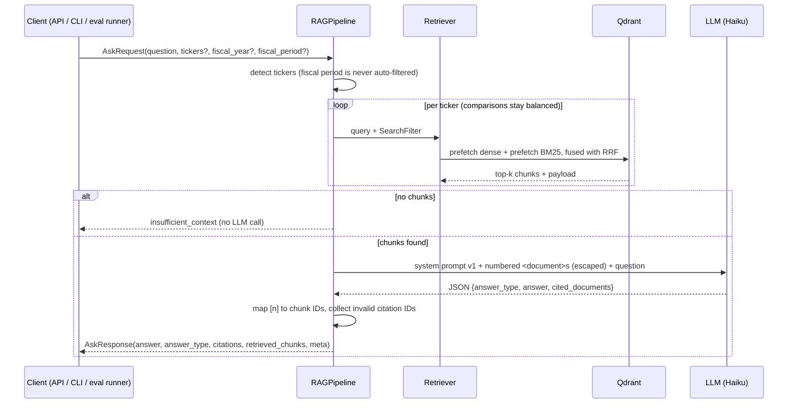
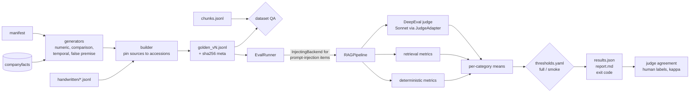
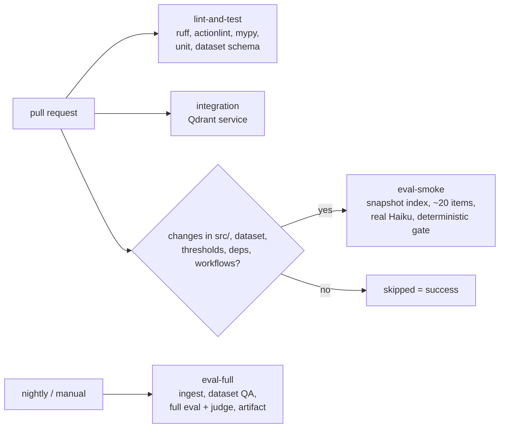

# Architecture

Three parts with clear interfaces between them:

1. **Ingestion** turns pinned filings into chunks (JSONL).
2. **RAG pipeline** (the system under test) turns a question into an `AskResponse`.
3. **Evaluation suite** turns golden items and `AskResponse`s into scores, gates and reports.

The eval suite talks to the bot only through `RAGPipeline.ask()` and the `AskResponse` schema,
the same contract the HTTP API exposes.

## Ingestion

Invariants (all unit-tested): no block is lost or duplicated by section splitting; chunks never
cross sections; chunk IDs are deterministic; fiscal metadata fails loudly when missing or
contradictory.

## Request flow

## Evaluation flow

## CI

## Module boundaries

| Module | Depends on | Must not depend on |
|---|---|---|
| `edgar`, `ingest` | stdlib, httpx, bs4 | Qdrant, LLM |
| `index` | `ingest.models`, qdrant-client, fastembed | LLM |
| `llm` | anthropic SDK | everything else |
| `rag` | `index`, `llm` | `evaluation` |
| `evaluation` | everything above, DeepEval | - (no app package imports it; only the CLI wires it in) |

These rules are enforced by `tests/unit/test_architecture.py`.
